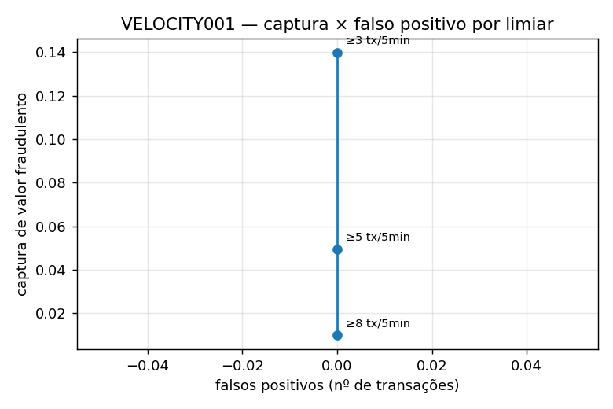
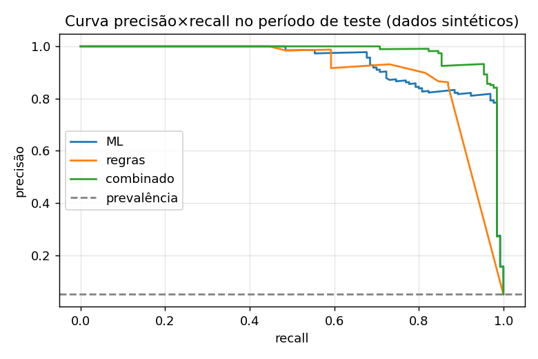

# Relatório — Pix-Fraud-Decisioning-Lab

> Dados 100% sintéticos; rótulos vêm do injetor de fraudes. Os números demonstram o pipeline, não desempenho em produção. Simulação educacional, sem integração com SPI/DICT.

Regras: v1.0.0 · seed 42

## Conjunto de dados
| transações | fraudes | taxa de fraude | quarentena (silver) | treino | teste | fraudes no teste |
|---|---|---|---|---|---|---|
| 8536 | 292 | 0.034 | 0 | 5122 | 2561 | 130 |

## PR-AUC no período de teste (split temporal com purga)
| ML | regras | combinado | prevalência (linha de base) |
|---|---|---|---|
| 0.937 | 0.848 | 0.975 | 0.051 |

## Decisões
| cenário | flagged | tp | fp | precision | recall | block_precision | fraud_value_captured_rate | false_positive_rate |
|---|---|---|---|---|---|---|---|---|
| regras (todo o período) | 291 | 233 | 58 | 0.801 | 0.798 | 1.000 | 0.943 | 0.007 |
| regras (teste) | 133 | 113 | 20 | 0.850 | 0.869 | 1.000 | 0.966 | 0.008 |
| combinado (teste) | 145 | 125 | 20 | 0.862 | 0.962 | 1.000 | 0.990 | 0.008 |

## Recall por padrão de fraude
| pattern | n_tx | rules_recall_all | n_tx_test | combined_recall_test |
|---|---|---|---|---|
| amount_anomaly | 10 | 1.000 | 3 | 1.000 |
| chain | 27 | 1.000 | 9 | 1.000 |
| cycle | 21 | 1.000 | 15 | 1.000 |
| device_takeover | 10 | 1.000 | 4 | 1.000 |
| fanout | 59 | 0.542 | 22 | 0.955 |
| mule | 84 | 1.000 | 55 | 1.000 |
| new_beneficiary | 10 | 1.000 | 6 | 1.000 |
| velocity | 71 | 0.549 | 16 | 0.750 |

## Desempenho por regra (todo o período)
| rule_id | hits | alerts | confirmed_fraud | false_positive | precision | recall | fraud_capture_rate | blocked_value | false_positive_cost |
|---|---|---|---|---|---|---|---|---|---|
| PIX001 | 13 | 13 | 10 | 3 | 0.769 | 0.034 | 0.182 | 102852.650 | 36.000 |
| PIX002 | 65 | 65 | 33 | 32 | 0.508 | 0.113 | 0.329 | 259609.920 | 384.000 |
| PIX003 | 95 | 83 | 68 | 27 | 0.716 | 0.233 | 0.563 | 369289.870 | 324.000 |
| VELOCITY001 | 55 | 16 | 55 | 0 | 1.000 | 0.188 | 0.050 | 23229.590 | 0.000 |
| DEVICE001 | 11 | 11 | 10 | 1 | 0.909 | 0.034 | 0.070 | 35689.860 | 12.000 |
| MULE001 | 46 | 46 | 28 | 18 | 0.609 | 0.096 | 0.073 | 37154.950 | 216.000 |
| MULE002 | 16 | 8 | 16 | 0 | 1.000 | 0.055 | 0.090 | 42147.180 | 0.000 |
| FANOUT001 | 27 | 8 | 27 | 0 | 1.000 | 0.092 | 0.034 | 15761.650 | 0.000 |
| GRAPH001 | 48 | 48 | 48 | 0 | 1.000 | 0.164 | 0.280 | 131135.370 | 0.000 |
| GRAPH002 | 84 | 68 | 84 | 0 | 1.000 | 0.288 | 0.280 | 131200.140 | 0.000 |
| MED001 | 61 | 52 | 60 | 1 | 0.984 | 0.205 | 0.241 | 113615.490 | 12.000 |

## Varredura de limiar — VELOCITY001.min_tx_5m
| param | value | hits | confirmed_fraud | false_positive | precision | recall | fraud_capture_rate | false_positive_cost |
|---|---|---|---|---|---|---|---|---|
| min_tx_5m | 3 | 105 | 105 | 0 | 1.000 | 0.360 | 0.140 | 0.000 |
| min_tx_5m | 5 | 55 | 55 | 0 | 1.000 | 0.188 | 0.050 | 0.000 |
| min_tx_5m | 8 | 15 | 15 | 0 | 1.000 | 0.051 | 0.010 | 0.000 |

## Curva precisão×recall

## Grafo
Transações sinalizadas pelo grafo: 132 · precisão: 1.000 · atraso mediano de detecção: 659.500 s (alerta retrospectivo em micro-batch).

## 10 maiores scores sinalizados
| tx_id | sender | amount | final_score | final_decision |
|---|---|---|---|---|
| T006675 | A0246 | 2279.540 | 0.997 | BLOCK |
| T007849 | X0111 | 2588.120 | 0.994 | BLOCK |
| T004796 | X0095 | 2900.180 | 0.994 | BLOCK |
| T004800 | X0096 | 2856.680 | 0.994 | BLOCK |
| T004939 | X0092 | 3300.630 | 0.994 | BLOCK |
| T007938 | X0103 | 3923.650 | 0.994 | BLOCK |
| T004941 | X0093 | 3251.120 | 0.994 | BLOCK |
| T007064 | X0098 | 4127.720 | 0.994 | BLOCK |
| T007837 | X0108 | 2708.170 | 0.994 | BLOCK |
| T007063 | X0097 | 4190.580 | 0.994 | BLOCK |
